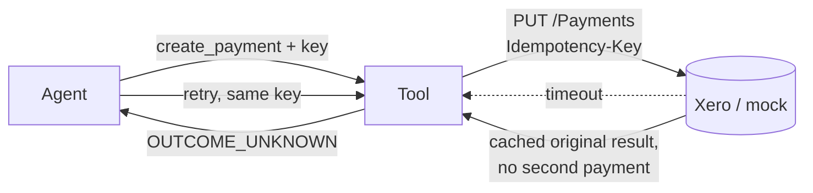

# Retry-safe payments for MCP agents

**If an AI agent's payment call times out, did the money move? Today the agent can't tell, so a retry can pay twice.**

This is an independent prototype against the Xero `create_payment` tool in Peakflo's open-source MCP server, [`peakflo/pfMCP`](https://github.com/peakflo/pfMCP). It makes payment retries safe when the outcome of the previous attempt is unknown.

> Student-built prototype and proposed reliability improvement. It is **not** an official Peakflo project and is **not** evidence of a confirmed production incident. All results come from a local mock of the Xero API, never real Xero accounts or money.

---

## The problem

1. An agent calls `create_payment`.
2. Xero processes it, but the response is slow or lost, and the client times out.
3. In the inspected code path, the agent receives only a generic error, so it treats the call as failed and retries as a **new** operation.
4. Result: **two payments**.

Reproduced locally (milestone M1):

| Scenario | Attempts | Payments recorded | Duplicates |
|---|---:|---:|---:|
| Normal call | 1 | 1 | 0 |
| Timeout → retry | 2 | 2 | **1** |

A timed-out `httpx` call raises `ReadTimeout`, whose message is an empty string. Through the server's catch-all handler, the agent-facing text becomes just `"Error: "`, which gives the agent nothing to reason about. This is inferred from the code plus the observed exception; the full MCP dispatcher was not executed.

While inspecting the code I also found that it creates payments with `POST /Payments`. Xero's documentation lists `PUT /Payments` for creating payments and uses `POST` on a payment ID for reversal. This is a documented-contract mismatch, not a verified production failure.

## The approach

- **Caller-supplied idempotency key.** It's generated once per logical payment and sent on every retry using Xero's documented `Idempotency-Key` header.
- **Explicit `OUTCOME_UNKNOWN` result.** Ambiguous transport failures are reported as "unknown", not "failed", so the agent knows it must not blindly create a new payment.
- **Reconcile before re-creating.** Xero remembers keys for only about six minutes, so after that window the caller checks payment state before trying again.



## What's in this repo

| Path | Contents |
|---|---|
| `mocks/fault_server.py` | A fault-injection mock of the Xero Payments API: delays, stalls, dropped responses and idempotency-key semantics, plus a ledger for counting real effects ([contract](mocks/MOCK_CONTRACT.md)) |
| `repro/` | Before/after reproduction scripts and recorded JSON results |
| `tests/` | Outcome classifier, fault server, tool, and integration/regression tests |
| `reviews/` | Gate reviews of each milestone by a separate reviewer agent, with the conditions raised and how they were closed |
| `BUILD_PLAN_peakflo.md`, `BUILD_LOG.md`, `STATUS.md` | Plan, evidence log and current state |

## Status

| Milestone | State |
|---|---|
| M0 Inspect the repository and environment | ✅ |
| M1 Reproduce the duplicate payment | ✅ reviewed |
| M2 Fault-injection mock Xero API | ✅ reviewed |
| M3 Minimal idempotent tool implementation | ✅ reviewed |
| M4 Integration and regression tests | ✅ built (94 prototype tests passing), review in progress |
| M5 Before/after demo · M6 agent retry evaluation · M7 docs · M8 final review | Not started |

## Running the tests

The tool tests import the Xero server from a local clone of `pfMCP`, so clone it as a sibling directory first:

```bash
git clone https://github.com/peakflo/pfMCP ../pfMCP
# install pfMCP's dependencies as described in its README, then:
pip install pytest pytest-asyncio httpx
pytest -q
```

---

Built by [Raj Magdum](https://github.com/RajMagdum05).
